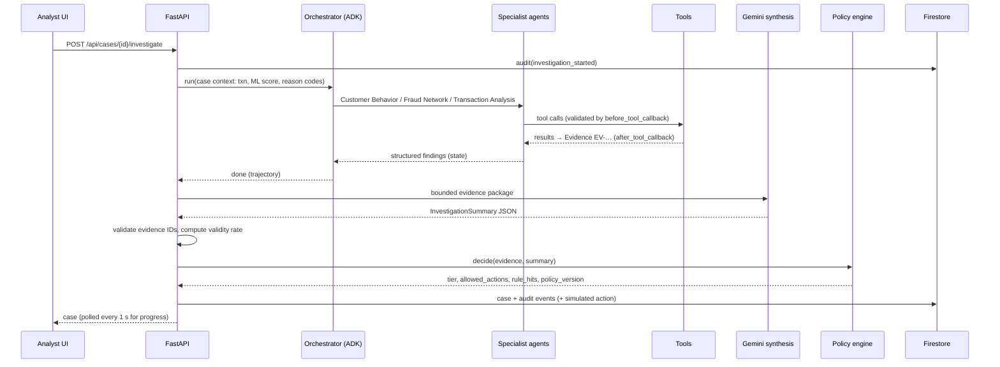

# Design Document: FraudLens AI MVP

## Overview

FraudLens is a single Cloud Run service (FastAPI + static React build) with three layers:

1. **Screening layer** (deterministic + ML, no LLM): features → rules → LightGBM + Isolation Forest → candidate.
2. **Investigation layer** (agentic): an ADK Orchestrator calls specialist agents, and they call deterministic tools → evidence items → Gemini synthesis (structured, evidence-linked).
3. **Decision layer** (deterministic): the policy engine assigns the tier → simulated action → case + audit in Firestore.

Design principle: *ML handles scale; tools provide verified evidence; agents orchestrate; Gemini synthesizes and explains; policy controls the action.*

## Architecture

```mermaid
flowchart LR
  subgraph Client
    UI[React Analyst App]
  end
  subgraph CR[Cloud Run: fraudlens]
    API[FastAPI /api]
    SCR[Screening: features + rules + LightGBM + IsoForest]
    ORCH[ADK Orchestrator Agent]
    CBA[Customer Behavior Agent]
    TAA[Transaction Analysis Agent]
    FNA[Fraud Network Agent]
    TOOLS[Deterministic Tools]
    SYN[Gemini Synthesis + Evidence Validator]
    POL[Policy Engine vN]
    CASES[Case + Audit Service]
    DATA[(In-memory data + NetworkX graph)]
  end
  GEM[Gemini on Agent Platform]
  FS[(Firestore: cases, audit)]
  GCS[(Cloud Storage: dataset, models, exports)]
  BQ[(BigQuery: optional analytics)]
  LOG[Cloud Logging / Monitoring]

  UI -->|/api| API
  API --> SCR --> DATA
  API --> ORCH
  ORCH --> CBA & TAA & FNA
  CBA & TAA & FNA --> TOOLS --> DATA
  ORCH -. LLM .-> GEM
  ORCH --> SYN -. LLM .-> GEM
  SYN --> POL --> CASES --> FS
  DATA <-. load at startup .- GCS
  DATA -. optional .- BQ
  CR --> LOG
```

### Investigation sequence



## Components and Interfaces

### Data layer (`app/data`)
- `generate.py`: seeded generator (Faker + numpy) that writes Parquet: `customers`, `accounts`, `devices`,
  `merchants`, `recipients`, `transactions`, `fraud_cases`, `labels`. It injects the scenario mix and the hero customer `CUST-HERO01`.
- `repository.py`: `DataRepository` interface with an in-memory pandas implementation (MVP) and a BigQuery implementation (stretch).
  It is loaded once at startup from `./data` or `gs://$BUCKET/data`.

### Features & screening (`app/features`, `app/ml`)
- `features/build.py`: vectorized point-in-time features (groupby customer, sorted by timestamp, shift before rolling).
- `ml/rules.py`: reason-code rules → `rules_score`.
- `ml/train.py`: time split (train ≤ day 60, val 61–75, test 76–90), LightGBM + IsolationForest, threshold calibration on val. Writes `models/` + `docs/metrics/detection_metrics.json`.
- `ml/score.py`: `score(txn) -> ScoreResult{risk_score, is_candidate, reason_codes, top_features, model_version}`; `score_batch(df)`.

### Graph (`app/graph`)
- `build.py`: NetworkX MultiDiGraph from the data, plus precomputed fraud distance, shared-device clusters, and recipient fan-in.
- `query.py`: `ego_graph(entity_id, hops=2, max_nodes=150)` → Cytoscape JSON.

### Tools (`app/tools`) — deterministic, typed, docstring'd (ADK reads the docstrings)

| Tool | Agent | Returns (→ Evidence kind) |
|---|---|---|
| `get_customer_profile(customer_id)` | Behavior | segment, account age, status, limits (`profile`) |
| `get_transaction_history(customer_id, days)` | Behavior | summary stats only, not raw rows (`history_summary`) |
| `get_account_limits(account_id)` | Behavior | limits, utilization (`limit_utilization`) |
| `calculate_customer_deviation(customer_id, transaction_id)` | Behavior | median, p95, ratio, MAD-z, cohort fallback (`amount_deviation`) |
| `calculate_velocity(account_id, transaction_id, windows)` | Transaction | count/value per window vs baseline (`velocity`) |
| `get_device_history(device_id)` | Transaction/Network | first_seen, linked accounts (`device_novelty`) |
| `get_merchant_history(customer_id, merchant_or_recipient_id)` | Transaction | prior interactions (`counterparty_familiarity`) |
| `get_ml_risk_score(transaction_id)` | Transaction | score, model_version, top features (`ml_score`) |
| `get_related_accounts(entity_id)` | Network | related entities (`relationships`) |
| `search_known_fraud_cases(entity_ids)` | Network | matched cases, status, recency (`known_fraud_link`) |
| `analyze_fraud_network(transaction_id)` | Network | path length to fraud, cluster size, fan-in (`network_metrics`) |
| `create_case`, `record_action`, `simulate_restriction` | **Not exposed to agents** | used by the case service only |

`Evidence` (Pydantic): `id, case_id, source_tool, kind, summary, observed: dict, baseline: dict|None, status (ok|unavailable|stale|conflicting), indicator_family (behavior|velocity|device|network|ml|limits), severity_hint, created_at`.

### Agents (`app/agents/fraudlens`)

```python
from google.adk.agents import LlmAgent
from google.adk.tools.agent_tool import AgentTool

behavior_agent = LlmAgent(name="customer_behavior_agent", model=MODEL, instruction=BEHAVIOR_PROMPT,
    description="Compares the transaction to the customer's own baseline and limits.",
    tools=[get_customer_profile, get_transaction_history, get_account_limits, calculate_customer_deviation],
    output_key="behavior_findings")
transaction_agent = LlmAgent(name="transaction_analysis_agent", ..., tools=[calculate_velocity, get_device_history, get_merchant_history, get_ml_risk_score], output_key="transaction_findings")
network_agent = LlmAgent(name="fraud_network_agent", ..., tools=[get_related_accounts, search_known_fraud_cases, analyze_fraud_network, get_device_history], output_key="network_findings")

root_agent = LlmAgent(name="fraudlens_orchestrator", model=MODEL, instruction=ORCHESTRATOR_PROMPT,
    tools=[AgentTool(behavior_agent), AgentTool(transaction_agent), AgentTool(network_agent)],
    before_tool_callback=guard_tool_call, after_tool_callback=capture_evidence)
```

- Run through `Runner` + `InMemorySessionService` (one session per case). Callbacks are attached to the specialists as well.
- `guard_tool_call`: enforces the call cap (12), validates ID formats and windows, and blocks unknown tools.
- `capture_evidence`: maps each tool result → Evidence items stored in the investigation context, and appends to the trajectory.
- **Fallback path** (and test double): if ADK/Gemini fails, `deterministic_investigation()` calls the same tools in a fixed order. The evidence still gets collected, the summary is `None`, and the status is `manual_review`.

### Synthesis (`app/ai/synthesis.py`)
- `build_evidence_package(evidence, case_ctx) -> str` (XML-delimited JSON, ≤ ~8k tokens).
- `synthesize(package) -> InvestigationSummary` (schema in `genai-standards.md`), `temperature=0.1`.
- `validate(summary, evidence_ids) -> (summary_clean, validity_rate, violations)`.

### Policy engine (`app/policy/engine.py`, `POLICY_VERSION = "2026.10.1"`)

Indicator families are counted only from `status=ok` evidence that is flagged as critical by thresholds in `policy/config.yaml`:

| Rule | Condition | Effect |
|---|---|---|
| R1 | `known_fraud_link` (confirmed, ≤ 180 days) AND ≥ 1 other critical family | Tier 3 |
| R2 | ≥ 3 critical families among {behavior, velocity, device, network, ml} | Tier 3 |
| R3 | ≥ 2 independent families | Tier 2 |
| R4 | 1 family or ML score ≥ threshold only | Tier 1 |
| R5 | Any `conflicting` evidence on a critical family | cap at Tier 2 + `requires_review` |
| R6 | Known fraud link `stale`/unverified | counts as a network signal, not R1 |
| R7 | `limited_history` | add flag; behavior family uses the cohort baseline |
| R8 | All synthesis unavailable | tier from rules only + `manual_review` |

Output: `PolicyDecision{tier, allowed_actions, rule_hits, requires_review, policy_version, llm_recommended_tier, disagreement: bool}`.
Actions: T1 → `monitoring_alert`; T2 → `customer_verification_simulated`, `analyst_escalation`; T3 → `restriction_simulated`, `immediate_escalation`.

### Case service (`app/cases`)
- Firestore: `cases/{case_id}` (status: `open|investigating|awaiting_review|manual_review|approved|modified|closed`), subcollections `evidence/{ev_id}`, `audit/{event_id}`, and `trajectory` (array on the case document, capped).
- `InMemoryCaseRepo` fallback with the same interface. It is used in tests and when Firestore is unreachable.
- Investigations run as a FastAPI background task. The UI polls `GET /api/cases/{id}` (status + progress steps).

### API (`/api`, all JSON)

| Method & path | Request | Response |
|---|---|---|
| `POST /transactions/score` | `Transaction` | `ScoreResult` |
| `POST /transactions/batch-score` | `{transactions[]}` or `{dataset:"test"}` | `{count, candidates, candidate_rate, latency_ms, candidate_ids[]}` |
| `GET /queue?status&tier&limit&cursor` | – | `{items:[QueueItem], next_cursor}` |
| `GET /customers/{id}/profile` | – | profile + limits + baseline |
| `GET /customers/{id}/history?days=30` | – | transactions + daily aggregates |
| `POST /cases` | `{transaction_id}` | `Case` (create from candidate, idempotent) |
| `GET /cases/{id}` | – | `Case` (evidence, summary, decision, trajectory, audit, progress) |
| `POST /cases/{id}/investigate` | – | `202 {status:"investigating"}` |
| `POST /cases/{id}/action` | `{action: approve|modify|close, tier?, reason}` | `AuditEvent` |
| `GET /cases/{id}/export` | – | JSON case bundle |
| `GET /network/{entity_id}` | – | Cytoscape `{nodes, edges, signals}` |
| `GET /metrics` | – | detection + benchmark + agentic + live ops metrics |
| `POST /demo/hero` | – | creates and investigates the hero case, returns `case_id` |
| `GET /healthz` | – | `{status:"ok", model_version, policy_version}` |

### Frontend
Pages and components as in `frontend-ux-accessibility.md`. TanStack Query for data and polling, Cytoscape
for the graph, Recharts for the dashboard and customer history. `types.ts` mirrors the Pydantic schemas.

## Data Models (key)

```text
Transaction{transaction_id, customer_id, account_id, timestamp, amount_paise:int, currency="INR",
            channel(upi|card|netbanking|imps), merchant_id?, recipient_id?, device_id, ip_hash, geo_city}
ScoreResult{transaction_id, risk_score:0..1, rules_score, anomaly_score, is_candidate, reason_codes[], top_features[{name,value,contribution}], model_version}
Case{case_id, transaction_id, customer_id, status, created_at, ml: ScoreResult, evidence_ids[],
     summary: InvestigationSummary|None, evidence_validity_rate, decision: PolicyDecision|None,
     trajectory[{step, agent, tool, args, status, latency_ms}], versions{model, prompt, policy, gemini_model}}
AuditEvent{event_id, case_id, event_type, actor, timestamp, payload_ref, evidence_ids[], versions}
```

## Error Handling

| Failure | Behavior |
|---|---|
| Invalid transaction | 422 with field errors |
| Tool exception or timeout (2 s) | Evidence `unavailable`; investigation continues |
| Gemini 429/5xx | SDK retries (4); then fallback → `manual_review` |
| Synthesis JSON invalid | One repair retry; then the summary is `None`, `manual_review` |
| Invalid evidence citations | Drop the finding, log the violation, lower confidence |
| Firestore unavailable | In-memory repo + degraded banner |
| Investigation > 25 s | Cancel, keep partial evidence, `manual_review` |

## Testing Strategy

- **Unit:** features (incl. the leakage test), rules, each tool (fixtures), policy engine (table-driven, one test per rule R1–R8), evidence validator, synthesis prompt builder (no PII, size cap).
- **API:** FastAPI TestClient with an in-memory repo and a mocked Gemini/ADK (the deterministic fallback).
- **Agent evals (real Gemini, on demand):** `evals/scenarios/*.json` for the hero ATO, benign high-value, mule network, card testing, limited history, and tool failure. Asserts tier range, required evidence kinds, zero invalid citations, and latency.
- **Benchmark:** `evals/run_benchmark.py` → `docs/metrics/benchmark.json` (A rules, B ML, C Jev* optional, D agentic on a sample).
- **UI:** vitest for components; a manual keyboard + Lighthouse pass via the Chrome DevTools MCP.

## Deployment

One Dockerfile (Node build → Python runtime), `gcloud run deploy fraudlens --source .`, service
account `fraudlens-run-sa`, env `GOOGLE_GENAI_USE_VERTEXAI=true, GOOGLE_CLOUD_PROJECT, GOOGLE_CLOUD_LOCATION=global,
GEMINI_MODEL, DEMO_MODE=true, DATA_URI, FIRESTORE_ENABLED`. Min 1 / max 5 instances, 2 vCPU / 2 GiB.
Generated data (seeded) and model artifacts are baked into the image for the MVP (small enough at
100k rows). The scale story is GCS/BigQuery.

## Security

Public demo on synthetic data, simulated actions, per-IP rate limits on mutating routes, a least-privilege
SA, no keys, append-only audit, Firestore rules denying client access, and evidence treated as untrusted
text in prompts. Production gaps (IAP/RBAC, real PII handling) are documented in the README.

## Risks

| Risk | Mitigation |
|---|---|
| Deadline (18 Oct) | Vertical slice first; Transaction Analysis Agent, Jev, BigQuery, and PDF export are stretch |
| Agent flakiness in the demo | Pre-seeded hero case + deterministic fallback + `--min-instances 1` |
| Hallucination | Evidence IDs, post-validation, tools-only numbers |
| Benchmark leakage | Time split + leakage unit test |
| Gemini quota | Escalate only candidates; cache the hero case result |
