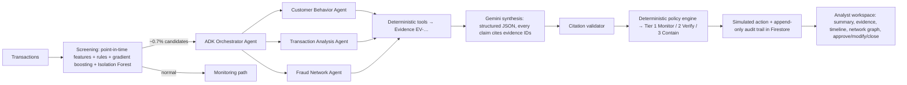

# FraudLens AI

**Agentic fraud detection, investigation and response on Google Cloud.**
FraudLens AI turns a suspicious transaction into an evidence-backed, reviewable fraud case in seconds.

> ⚠️ Hackathon prototype on **synthetic data**. All account actions are **simulated**. Not a production banking system.

| | |
|---|---|
| Live demo | [https://fraudlens-579191985047.us-central1.run.app](https://fraudlens-579191985047.us-central1.run.app) (scales to zero; the first visit may take ~15 s to wake up) |
| Demo video (≤ 3 min) | _link added after recording_ |
| Category / theme | Intelligent Risk, Fraud & Financial Experiences (BFSI) |
| Google AI | Gemini (via Gemini Enterprise Agent Platform / Vertex AI) · Agent Development Kit (ADK) |
| Deployment | Cloud Run · Firestore · Cloud Logging |

## Why

Banks see huge volumes of legitimate transactions and a tiny share of fraud. Sending everything to an LLM is
slow and expensive; fixed rules create false positives; black-box scores give analysts no evidence. FraudLens
separates the problems:

**ML handles scale · tools provide verified evidence · agents orchestrate · Gemini synthesizes and explains · policy controls the action.**

## How it works



* **Screening (no LLM):** 27 point-in-time features (customer baseline deviation, velocity windows, device
  novelty/sharing, counterparty age and fan-in, links to confirmed fraud, limit utilisation), a transparent
  rules baseline with reason codes, and an ML blend. Time-based split; thresholds calibrated on validation.
* **Agentic investigation:** an ADK orchestrator delegates to three specialist agents, each restricted to its own
  tools. Callbacks block action tools, enforce a tool budget, validate IDs, convert every tool result into
  evidence with a stable ID, and record the trajectory shown in the UI.
* **Grounded synthesis:** Gemini receives only a bounded evidence package (no raw history, pseudonymous IDs) and
  must return `InvestigationSummary` JSON. Findings citing unknown evidence IDs are dropped and the evidence
  validity rate is recorded.
* **Policy, not the LLM, decides:** rules R1–R8 (fraud link + activity, ≥ 3 critical families, conflicts,
  stale links, limited history, missing AI). Gemini's tier is advisory and disagreements are shown.
* **Graceful degradation:** if Gemini or a tool fails, the ML score and deterministic evidence are kept, missing
  evidence is marked `unavailable`, and the case goes to manual review.
* **Progressive autonomy, human decides:** every case carries an autonomy level on a four-step ladder
  (L1 manual · L2 AI investigates, human decides · L3 AI recommends with sampled review · L4 auto-close within
  guardrails). FraudLens runs at **L2** (L1 when the AI is unavailable). Monitor-tier cases are the only ones
  eligible for L3 after shadow-mode validation; Verify / Contain are capped at L2 by design.
* **Resolve, not just alert:** the analyst opens a finished investigation package (evidence, timeline, network,
  cited summary and a deterministic *assumptions & limitations* list) instead of a blank page. Risk is shown on a
  bank-familiar 0–1000 scale (display only; the model output is unchanged).
* **Overrides are the feedback loop:** approving keeps the policy tier; changing it or closing a Tier 2/3 case is
  an override that requires a reason, is written to the append-only audit trail, and feeds live
  analyst-vs-policy and analyst-vs-Gemini agreement rates on the metrics page.

## Measured results (synthetic held-out test split)

All numbers are produced by scripts and stored in [`docs/metrics/`](docs/metrics). Do not edit them by hand.

| Variant | Precision | Recall | PR-AUC | FP / 10k | Candidate rate | Fraud value captured |
|---|---|---|---|---|---|---|
| A · Rules only | 0.9216 | 0.6589 | 0.6747 | 3.89 | 0.00496 | 92.36% |
| B · ML + anomaly + rules | 0.8235 | 0.8505 | 0.8998 | 12.65 | 0.00717 | 73.67% |

Source: `docs/metrics/detection_metrics.json` (30,828 test transactions, 214 fraud).

**Variant D: B + agentic Gemini investigation.** Real Gemini runs on 12 stratified test candidates (8 fraud,
4 legitimate) plus the hero and benign golden scenarios, policy 2026.10.2:

| Gemini escalation rate | Tier-vs-label agreement | Evidence validity | Invalid citations | Latency p50 / p95 | Tokens per case (in / out) | LLM cost per case | LLM cost per 1,000 txns |
|---|---|---|---|---|---|---|---|
| 0.00717 | 0.8333 | 1.0 | 0 | 18.8 s / 23.2 s | 12,796 / 4,538 | $0.06003 | $0.43037 |

Source: `docs/metrics/agentic_eval.json` and `benchmark.json`. Cost uses Gemini 3.5 Flash list prices
(`backend/evals/pricing.json`). The sample is small; treat agreement as indicative.

**Variant C: B + Laya decision-model routing** (open-weight Laya `laya-typed-decisions`, zero-shot, on all 221 test
candidates):

| Laya routed to "investigate" | Precision | Recall | Gemini escalations avoided | AUC P(account takeover) / P(mule) | Laya latency p50 / p95 (CPU) |
|---|---|---|---|---|---|
| 221 of 221 | 0.8235 | 0.8505 | 0.0 | 0.3451 / 0.6974 | 9.4 s / 10.5 s |

Zero-shot Laya adds no measured value over B on this task, so it is **advisory only**: in the live deployment
(`ENABLE_LAYA=true`) it runs in parallel with the agents, appears as one ML-family evidence item and a triage panel,
is compared with the policy tier (disagreements are flagged), and never sets the tier. Locally it defaults to
`ENABLE_LAYA=false`. Source: `docs/metrics/laya_eval.json`. See `docs/DECISIONS.md`.

## Run locally

Prerequisites: Python 3.12 via [uv](https://docs.astral.sh/uv/), Node 22, gcloud CLI.

```bash
cd backend
uv sync
uv run python -m app.data.generate --seed 42     # synthetic dataset (~180k transactions)
uv run python -m app.ml.train                    # screening models + docs/metrics/detection_metrics.json
uv run pytest -q

cd ../frontend && npm ci && npm run build && cd ../backend
cp .env.example .env                             # set GOOGLE_CLOUD_PROJECT; or GEMINI_ENABLED=false
gcloud auth application-default login            # Gemini via ADC, no API keys
uv run uvicorn app.main:app --port 8080          # open http://localhost:8080
```

Agent dev UI: `uv run adk web app/agents`. Benchmark: `uv run python -m evals.run_benchmark --sample 12`.

## Deploy to Google Cloud

```bash
PROJECT_ID=<project> REGION=us-central1 ./infra/setup.sh    # APIs, service account, IAM, Firestore
PROJECT_ID=<project> REGION=us-central1 ./infra/deploy.sh   # Cloud Build → Cloud Run (single service)
```

## Security & responsible AI

* No secrets in code; Cloud Run uses a dedicated least-privilege service account (`aiplatform.user`,
  `datastore.user`, `logging.logWriter`, `monitoring.metricWriter`) and Application Default Credentials.
* **Public demo access:** the service is deployed with `--allow-unauthenticated` because it serves synthetic data
  only and every action is simulated. Mutating endpoints are rate-limited per IP and request bodies are capped.
  A production deployment would require Identity Platform / IAP with analyst vs supervisor roles.
* LLM guardrails: evidence-only prompts, data/instruction separation, schema-constrained output, citation
  validation, tool allow-lists per agent, action tools never exposed to agents, append-only audit trail.
* Thresholds are prototype policy values calibrated on synthetic data, not banking standards.

## Repository layout

`backend/app` (FastAPI, data, features, ML, graph, tools, ADK agents, Gemini synthesis, policy, cases) ·
`backend/tests` · `backend/evals` · `frontend/src` (React + TypeScript + Tailwind) · `infra/` · `docs/`.
