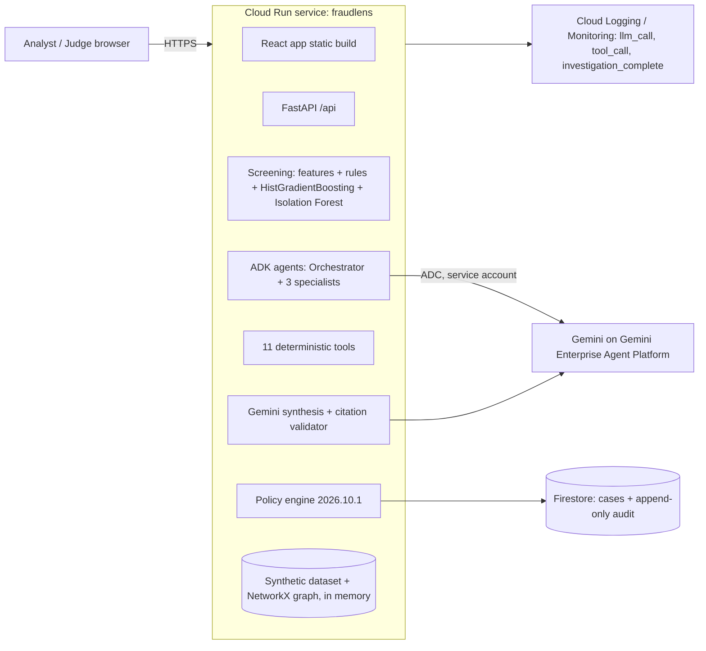

# FraudLens AI · Architecture

## Deployment (Google Cloud)



One container image (Node build stage + Python 3.12 runtime) serves the UI and API from one URL.

**Optional Variant C: the `fraudlens-laya` Cloud Run service.** A private service (`--no-allow-unauthenticated`;
only `fraudlens-run-sa` holds `run.invoker`) runs the open-weight Laya decision model on CPU. Weights are pinned
and baked into the image, the service runs offline, and its own service account has no data access. The main app
calls it with a Google-signed ID token from the metadata server, sending only pseudonymous, tool-computed
features. It is disabled by default (`ENABLE_LAYA=false`): see the benchmark in `docs/metrics/laya_eval.json`.
Identity: a dedicated service account `fraudlens-run-sa` with `aiplatform.user`, `datastore.user`, `logging.logWriter`
and `monitoring.metricWriter`. There are no API keys.

## Request flows

| Flow | Path | LLM? | Typical latency |
|---|---|---|---|
| Score one transaction | `POST /api/transactions/score` → point-in-time features from related history → models → reason codes | No | measured in `/api/metrics` |
| Batch screening | `POST /api/transactions/batch-score` → precomputed vectorised scores | No | see `detection_metrics.json` |
| Investigate a candidate | `POST /api/cases/{id}/investigate` → background task → ADK agents → tools → evidence → Gemini synthesis → policy → Firestore | Yes (candidates only) | see `agentic_eval.json` |
| Analyst decision | `POST /api/cases/{id}/action` (approve / modify with reason / close) → audit event | No | n/a |

## Investigation internals

```mermaid
sequenceDiagram
  participant O as Orchestrator (ADK LlmAgent)
  participant S as Specialist (AgentTool)
  participant CB as Callbacks
  participant T as Tool
  participant C as InvestigationContext
  O->>S: request with IDs
  S->>CB: before_tool_callback(tool, args)
  CB->>C: guard: action tool? budget? ID format?
  alt blocked
    CB-->>S: {status: blocked}
  else allowed
    S->>T: call
    T-->>CB: after_tool_callback(result)
    CB->>C: result → Evidence EV-…; trajectory step
    CB-->>S: compact evidence with IDs
  end
  Note over C: on tool exception → Evidence status "unavailable"
  O-->>C: done → deterministic completion of any missing critical evidence
  C->>C: evidence package (bounded, no PII) → Gemini InvestigationSummary → drop invalid citations
  C->>C: policy.decide() → tier + simulated actions → audit
```

## Failure modes

| Failure | Behaviour |
|---|---|
| Gemini / ADK error or timeout | Keep ML score, deterministic evidence, policy tier; status `manual_review`; UI explains |
| Hero demo re-run fails | Last good AI result restored and labelled (audit event `restored_last_good_result`) |
| Tool error | Evidence with status `unavailable`, listed in policy flags; never inferred |
| Invalid citations | Finding dropped; validity rate recorded; confidence lowered if > 20% invalid |
| Firestore unreachable | In-memory store, "degraded" shown in the dashboard |
| Abuse | Per-IP rate limits on mutating routes, 256 KB body cap, ID validation, `max_llm_calls` cap |

## Scaling path (beyond the prototype)

* Screening is stateless and vectorised: scale out Cloud Run instances, or move batch scoring to Cloud Run Jobs.
* Swap `DataRepository` for a BigQuery-backed implementation; stream transactions through Pub/Sub.
* Graph: NetworkX in memory now → Spanner Graph for production-size entity graphs.
* LLM cost grows with the candidate count, not total volume (Gemini escalation rate < 1% of transactions here).
* Security: IAP / Identity Platform with analyst vs supervisor roles; VPC-SC around Gemini and data.
