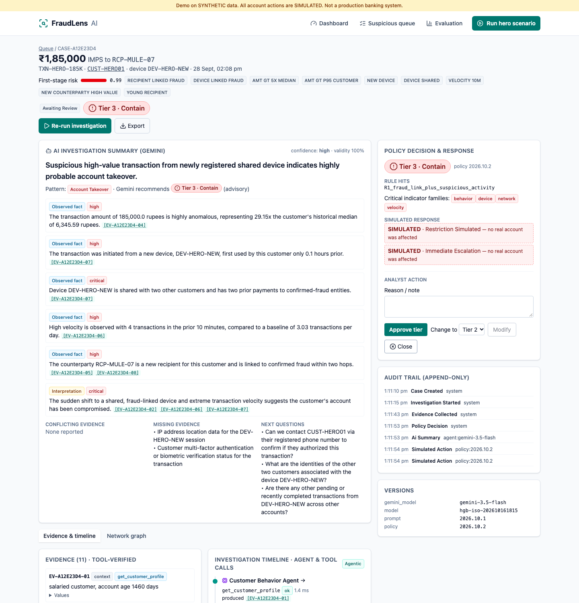
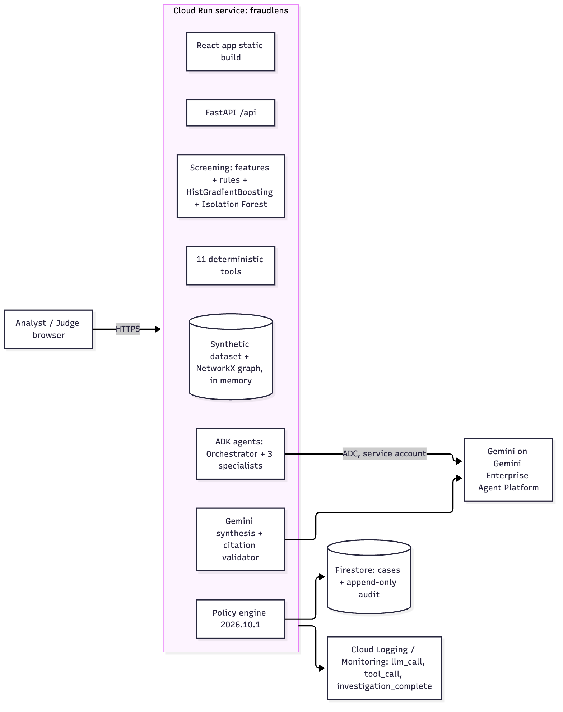

# FraudLens AI
## A suspicious transaction → an evidence-backed, reviewable fraud case in seconds

**Theme:** Intelligent Risk, Fraud & Financial Experiences (BFSI)
**Built with:** Gemini · Agent Development Kit · Cloud Run · Firestore

<span class="pill">Prototype on synthetic data · all actions simulated</span>

<p class="small">Team: [names] · AI Builder Cup 2026</p>

---

## The problem

- Banks process huge volumes of legitimate payments; fraud is a tiny fraction.
- **Sending every transaction to an LLM** is slow and expensive.
- **Fixed rules** flag customers whose normal behaviour simply differs, creating false positives.
- **Black-box scores** give analysts no evidence to act on.
- **Autonomous blocking by an LLM** is unsafe and unauditable.

**Analysts need context, evidence and a controlled response, at scale.**

---

## Who we help

| Persona | Today | With FraudLens |
|---|---|---|
| Fraud analyst | Alert queue + 5 screens to piece together context | One case workspace: evidence, timeline, network, AI summary |
| Risk / operations | Inconsistent responses | Deterministic, versioned risk tiers |
| Customer protection | Account takeover noticed late | Device, velocity and network signals combined |
| Auditors / ML team | Opaque decisions | Every claim tied to evidence IDs; full audit trail |

---

## The solution: layered by design

**ML handles scale → tools provide verified evidence → agents orchestrate → Gemini explains → policy controls the action**

1. **Screen** every transaction with point-in-time features, rules and ML (no LLM).
2. **Investigate** only candidates with an ADK multi-agent team calling deterministic tools.
3. **Synthesize** with Gemini: structured JSON in which every finding cites evidence IDs.
4. **Decide** with a deterministic policy engine: Tier 1 Monitor / 2 Verify / 3 Contain.
5. **Respond** with a simulated action, analyst approval and an append-only audit trail.

---

## Demo: the ₹1,85,000 transfer



- Customer normally makes 2–4 payments/day, median ≈ ₹6,000.
- A ₹1,85,000 IMPS transfer arrives from a device first seen minutes earlier, after 4 rapid payments.
- The recipient shares a device with confirmed-fraud mule accounts.
- Agents gather behaviour, velocity, device and network evidence.
- The policy engine applies **R1: fraud link + suspicious activity → Tier 3 Contain (SIMULATED)**.

---

## How Gemini and agents make it possible

```
Orchestrator (Gemini, ADK)
 ├─ Customer Behavior Agent → deviation · history · limits
 ├─ Transaction Analysis Agent → velocity · device · counterparty · ML score
 └─ Fraud Network Agent → network paths · known fraud · related accounts
          ↓ every tool result becomes Evidence EV-…
Gemini synthesis → InvestigationSummary JSON (findings cite evidence IDs)
          ↓ citation validator drops unsupported claims
Policy engine (deterministic) → tier + allowed simulated actions
```

Callbacks block action tools, enforce a tool budget and validate IDs.

---

## Grounded and safe by construction

- **Tools compute, Gemini reasons:** no LLM arithmetic, no invented values.
- **Evidence IDs on every claim;** unsupported findings are removed and the **evidence validity rate** is tracked.
- Observed facts vs interpretations; **missing and conflicting evidence** shown explicitly.
- **Gemini's tier is advisory;** the deterministic policy decides and disagreements are surfaced.
- Tool failure → evidence marked *unavailable*, never guessed. Gemini failure → manual review.
- Synthetic, pseudonymous data; bounded evidence package; append-only audit.

---

## Architecture on Google Cloud



- **Cloud Run:** one container, UI + API
- **Gemini** via ADC, no API keys
- **ADK:** orchestrator + 3 specialists
- **Firestore:** cases + append-only audit
- **Cloud Logging:** LLM/tool calls, latency, tokens
- Least-privilege service account

---

## Impact: how much better (held-out test split, 30,828 transactions)

| Outcome | Rules only | **FraudLens** | Change |
|---|---|---|---|
| Frauds caught (of 214) | 141 | **182** | **+41 (+29%)** |
| Frauds missed | 73 | **32** | **−56%** |
| Ranking quality (PR-AUC) | 0.6747 | **0.8998** | **+33%** |
| LLM cost / 1,000 txns | $60.03 if every txn investigated | **$0.43** | **139× cheaper** |

- **97.8%** of auto-escalated cases were real fraud (137 escalations)
- **100%** of Gemini findings grounded in real evidence, **0** invalid citations
- Account takeover 31→**62/62**, card testing 77→**98/98**

**Trade-off we show, not hide:** 39 false alarms vs 12, and mule/new-customer recall dropped. Next fix, already measured: rules **OR** ML catches **195 (91.1%)** at 79.9% precision.

<p class="small">Source: docs/metrics/impact.json (generated by evals/run_impact.py). No hand-entered numbers.</p>

---

## Measured results (synthetic held-out test split, 30,828 transactions)

| Variant | Precision | Recall | PR-AUC | FP / 10k | Candidate rate |
|---|---|---|---|---|---|
| A · Rules only | 0.9216 | 0.6589 | 0.6747 | 3.89 | 0.00496 |
| B · ML + anomaly + rules | 0.8235 | 0.8505 | 0.8998 | 12.65 | 0.00717 |
**D · B + agentic Gemini investigation** (real Gemini runs, policy 2026.10.2; 12 sampled test candidates + 2 golden scenarios)

| Gemini escalation rate | Tier-vs-label agreement | Evidence validity | Invalid citations | Latency p50 / p95 | LLM cost / 1,000 txns |
|---|---|---|---|---|---|
| 0.00717 | 0.8333 | 1.0 | 0 | 18.8 s / 23.2 s | $0.43037 |

**C · B + Laya open decision model (zero-shot):** routed 221 of 221 candidates to "investigate", so it matched B
(precision 0.8235, recall 0.8505) with 0.0 escalations avoided → **kept off the critical path** (BRD rule).

<p class="small">Source: docs/metrics/detection_metrics.json · benchmark.json · agentic_eval.json. No hand-entered numbers.</p>

---

## What's different

| | Rules engine | ML score only | LLM chatbot | **FraudLens** |
|---|---|---|---|---|
| Scales to all transactions | ✅ | ✅ | ❌ | ✅ |
| Customer-specific baselines | ❌ | partly | ❌ | ✅ |
| Network / mule intelligence | ❌ | partly | ❌ | ✅ |
| Explains with evidence | codes | ❌ | unsupported text | ✅ cited |
| Safe, auditable action | ✅ | ❌ | ❌ | ✅ policy + human |

---

## Feasibility, scale and roadmap

**Live today:** screening, 11 tools, 4 agents, Gemini synthesis, policy engine, case workspace, audit, Cloud Run.

**Scale path:** BigQuery repository and Pub/Sub streaming · Cloud Run Jobs for batch · Spanner Graph · LLM cost tied
to candidate volume, not total volume.

**Next 6 months:** pilot with a bank fraud team on anonymised data · IAP/RBAC · threshold calibration on real
labels · analyst feedback loop · optional decision-model router benchmark.

---

# Try it

**Live demo:** https://fraudlens-579191985047.us-central1.run.app
**Video (≤ 3 min):** [link]
**Code:** [GitHub repo]

Click **Run hero scenario** → watch the agents investigate → approve the Tier 3 case.

<p class="small">Synthetic data only. All account actions are simulated. Not a production banking system.</p>
